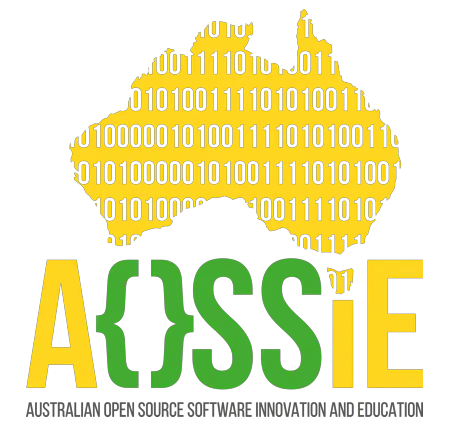
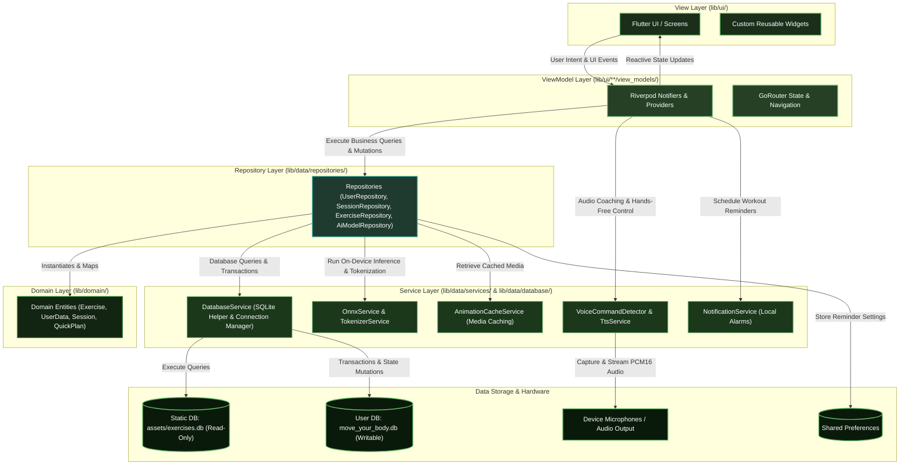

  
  &nbsp;&nbsp;&nbsp;&nbsp;&nbsp;
  
  &nbsp;&nbsp;&nbsp;&nbsp;&nbsp;
  

# Google Summer of Code 2026 End-Term Evaluation

**Project:** MoveYourBody: AI Powered Personalized Fitness and Workout Application

**Organization:** [Australian Open Source Software Innovation and Education (AOSSIE)](https://aossie.org/en)

**Project Size:** Large (350+ hours)

**Name:** Vaibhav Aryan

**GitHub:** https://github.com/DecodeX15

**LinkedIn:** https://www.linkedin.com/in/vaibhav-aryan-00650b287

**Project Repository:** https://github.com/AOSSIE-Org/MoveYourBody

**GSoC Project Page:** https://summerofcode.withgoogle.com/programs/2026/projects/GS2OzCEu

**Submitted GSoC Proposal:** https://docs.google.com/document/d/1T5s-sog4MyU4D-vZQ1IxQl4BZKOYcBh2RQfVZWAhdB0/edit?tab=t.0#heading=h.losp2ob4u62u

## Project Overview

MoveYourBody is an open-source, privacy-focused fitness application designed to make physical activity more accessible through short, personalized workout sessions. It aims to help users build consistent exercise habits without requiring long workout routines, continuous internet connectivity, focusing on reducing workout boredom through varied, personalized exercise recommendations while providing an ad-free fitness experience without distracting advertisements.
During Google Summer of Code 2026, I transformed the initial ideas for MoveYourBody into a functional mobile application, bringing the project vision to real life.

## 1. Work Done During GSoC 2026

### Technical Architecture

MoveYourBody was developed using Flutter and Dart, following the MVVM architectural pattern with repository and service layers. Riverpod is used for state management and dependency injection. ViewModels manage app state, repositories handle data access, and services handle database operations, on-device ML, voice commands, text-to-speech, caching, and notifications. This separation keeps the code organized, easier to maintain, and easier to understand.

### UI/UX and Local Data Persistence

Designed multiple screens, including onboarding, home, explore, workout execution, and stats, with a consistent theme, good color contrast, and a simple, easy to understand layout. The interface focuses on providing a smooth experience, helping users get started quickly and navigate between features easily. I Implemented local data storage using SQLite for structured data, such as exercises and workout sessions, and SharedPreferences for storing user preferences and onboarding status. This allows the app to retain important user data and support its offline-first functionality.

### Embedding Pipeline for Semantic Understanding

Before this work, my experience was mainly in web/app development, and I had not explored much of the machine learning side. During GSoC, I integrated the `all-MiniLM-L6-v2` model using ONNX Runtime and worked on its WordPiece tokenizer to prepare text for inference. The model generates embeddings for user fitness goals, which are compared with pre-generated exercise embeddings using cosine similarity. This helps identify exercises that are semantically related to the user's goals, even when the exact words are different.The model runs locally on the device and I also tested it across multiple devices to measure inference time and check its performance. This ensures that recommendations do not depend on external AI services.

### Personalized Exercise Recommendation Engine

I built a recommendation engine which combines semantic matching with exercise eligibility checks and ranking logic, it does not simply selecting exercises with the highest similarity scores, the application considers whether an exercise is suitable for the user's configured preferences and constraints for that i have implemented this pipeline and i have also taken feedback from my mentor this make sure to personalises recommendations for each user.

The pipeline follows these stages:

1. **User profile interpretation:** Uses onboarding information and resolved fitness-goal and health-related tags.
2. **Safety filtering:** Excludes exercises that conflict with configured health limitations or contraindications.
3. **Equipment filtering:** Removes exercises requiring equipment that is unavailable to the user.
4. **Variety filtering:** Checks recent workout history to avoid unnecessary repetition.
5. **Exercise ranking:** Scores eligible exercises using factors such as goal relevance, target body region, difficulty, and intensity.
6. **Recommendation selection:** Sorts the eligible exercises and selects suitable candidates for the workout.

This layered design separates safety and eligibility requirements from recommendation ranking.

### Workout Variety and Boredom Reduction

Reducing workout boredom was an important part of the project, as it was a problem and idea raised by my mentor during early GSoC period, repeated exercises can make workouts monotonous and reduce user motivation, potentially causing users to skip sessions.
I implemented history-aware recommendation filtering to avoid repeating exercises from recent completed sessions whenever suitable alternatives are available. I integrated this mechanism directly into the recommendation engine, while ensuring that recommended exercises still meet safety, equipment, and relevance requirements, but after implementing it, I tested an edge case where the limited exercise catalog could result in all exercises being marked as recently used, so to handle this, I implemented a fallback mechanism too which can relax the repetition restriction when too few eligible exercises remain, ensuring that the user still receives a complete workout session.

### Workout Session Execution

I implemented the workout execution flow as a sequence of phases, including preparation, exercise execution, rest intervals, completion, and post-workout feedback, for this there is one session viewmodel to manage phase transitions, timers, exercise instructions, and user actions, I also implemented session status persistence using localdb so the application can identify active, incomplete, and completed sessions, during application startup, and there is one check for incomplete sessions which is allowing users to resume interrupted workouts and also keeping track of completed exercises and session feedback, which supports activity history and future recommendation adjustments.

### Feedback-Based Difficulty and Intensity Adaptation

I implemented feedback-based personalization to adjust workout difficulty and intensity based on user experience with completed sessions, initially, I was using only the latest feedback and updating the user fields for adjustments in the next session, but then I noticed too much variation in the results, so I changed my approach to consider the latest three completed sessions to identify consistent patterns, for example, repeated feedback that workouts are too easy can lead to an increase in difficulty, while feedback that workouts are too hard can lead to a reduction, I also handled intensity feedback separately so that difficulty and intensity are adjusted independently, this avoids changing workout settings based on a single response and helps make subsequent recommendations more suitable for the user.

### Tag Embedding Precomputation and Performance Optimization

Initially, I was generating exercise tag embeddings on the device during onboarding, which required multiple model inference operations and caused significant loading delays. To improve this, I moved the generation of static exercise embeddings to a github actions workflow using a python script, this script extracts unique exercise tags, generates their embeddings using the ONNX model, and stores them in the SQLite database, which is then bundled with the app, this approach avoids repeatedly generating embeddings on the user device at runtime and significantly reduces onboarding time from around 50–55 seconds to approximately 4 seconds.

### Exercise Search, Quick and Custom Workout Plans

I implemented an exercise search feature using fuzzy matching, allowing users to find exercises even when they enter partial names or slightly different search terms. I also added quick workout plans that provide ready-made routines targeting specific body parts, giving users an easy way to start a workout without creating a plan themselves. Additionally, there is custom workout functionality also which is allowing users to select their preferred exercises and create their own workout plans. These features give users more flexibility and control over their workout choices.

### Exercise Animations and Media Caching

I implemented an animation caching service using `flutter_cache_manager` to avoid repeatedly downloading exercise animations. Animation requests are handled through ExerciseRepository and AnimationCacheService, which stores downloaded media locally and serves cached files when available, it allows users to access previously viewed exercise animations offline, while an internet connection is still required to download new media.

### Local Notifications and Workout Reminders

I implemented a local notification system for scheduling workout reminders directly on the device without requiring a backend service. I also handled local storage of reminder preferences, timezone-aware scheduling, and the Android configuration needed to deliver scheduled notifications. This allows workout reminders to be scheduled directly on the device without sending personal workout schedules to an server.

### Activity Statistics and Workout History

I added `fl_chart` to implement an activity statistics section that helps users track their workout progress and consistency, allowing them to see the impact of even their 5-minute workouts. It includes weekly charts for calories burned and workout duration, along with a monthly activity calendar to view workout history. I also added screens where users can explore their previous workout sessions and view details such as completed exercises, workout duration, calories burned, and difficulty and intensity feedback.

### Offline Voice Commands and Audio Coaching

I implemented a voice command feature that allows users to control workout sessions using predefined commands such as START, STOP, and SKIP, so instead of relying on a complete speech recognition model, I implemented a template-based audio processing approach. The system continuously captures microphone input using the record package in PCM16 format and processes the audio to extract Mel-Frequency Cepstral Coefficients (MFCCs), which represent important characteristics of the speech signal. It then uses Dynamic Time Warping (DTW) to compare the extracted features with predefined voice command templates. The system calculates a distance for each template and selects the best match. If the lowest distance is within the configured threshold, the command is accepted and the corresponding workout action is executed else the input is ignored. I also integrated Text-to-Speech (TTS) to provide spoken exercise instructions and feedback, helping users follow their workouts correctly and to prevent the microphone from capturing the application own spoken output as a user command, I added recording control that temporarily pauses voice detection while TTS is speaking.

### App Navigation

I implemented app navigation using `go_router` and `StatefulShellRoute.indexedStack` to maintain the state of different navigation tabs. This allows users to switch between screens and return to the same position without losing their previous scroll position or screen state. I also configured navigation for workout sessions, exercise details, and the initial onboarding flow to provide a smooth navigation experience throughout the app.

### Testing and Quality Assurance

I wrote unit and widget tests using Flutter testing framework and mocking utilities. I covered different layers of the application, including Views, ViewModels, repositories, and services. Mock dependencies allowed me to test component behavior without always relying on a real database or device services. I also tested database operations and workout-session handling to ensure that session data and workout history were handled correctly. In addition to automated tests, I manually tested the application functionalities on two physical devices and two emulators to verify that the features and UI worked as expected across different environments.

### CI/CD and Google Play Store Deployment

I created multiple GitHub Actions workflows to automate the project CI/CD process and reduce manual work during development and releases, one workflow runs on every pull request and performs mandatory CI checks and these checks help identify formatting issues, potential code problems, and failing tests before changes are merged into the main branch.
I also implemented an automated release workflow that runs when code is merged into the main branch and it builds the android release application using signing keys and deployment credentials stored in GitHub secrets. The workflow then prepares the release and submits the application build to Google Play Console for distribution.

## 2. Challenges and Engineering Decisions

### On-Device Model Selection and Resource Constraints

Selecting a suitable semantic embedding model for android devices was challenging because the model needed to be lightweight while providing useful results. I evaluated different models and selected all-MiniLM-L6-v2, integrating it with ONNX Runtime to generate embeddings directly on the device.

### Reducing Onboarding Loading Time

Initially, the application generated embeddings for all predefined exercise tags during onboarding, which increased the initial setup time. I addressed this by creating a Python script to precompute these embeddings and integrating it into GitHub Actions, allowing the generated data to be packaged with the application.

### Native Audio Dependencies and Offline Voice Processing

One of the challenges was implementing voice commands alongside TTS instructions. My initial approach used STT and TTS together, repeatedly starting and stopping STT produced an audible buzz, which affected the user experience, so to improve this I spent around a week researching and exploring alternatives to improve this experience. I explored different flutter packages for offline speech recognition, native android speech recognition, wake-word-based approaches, and sherpa-ONNX. Some packages were useful but had not been maintained for a long time, while Sherpa-ONNX introduced native dependency and ONNX Runtime compatibility issues with the existing flutter_onnxruntime integration. I was also considering the impact of integrating a separate voice recognition model, as having two ML models in the application could increase its size and create additional memory and performance overhead on mobile devices. After considering these limitations and exploring different alternatives, I settled on a different approach, which is explained in the Offline Voice Commands and Audio Coaching section above.

## 3. Summary of Work and Pull Request Contributions

During GSoC 2026, I contributed 85+ commits and 70k+ lines of code to MoveYourBody, resulting in 27 merged Pull Requests, with 2 more under review. I actively collaborated with mentors and fellow contributors, and included video demonstrations with each PR wherever applicable.

### Pull Requests Merged Before Mid-Evaluation

| Pull Request | Title | Contribution |
|:---|:---:|:---|
| [PR #1](https://github.com/AOSSIE-Org/MoveYourBody/pull/1) | Add onboarding flow and state management foundation | Implemented the initial onboarding screens and established the application's state management foundation. |
| [PR #2](https://github.com/AOSSIE-Org/MoveYourBody/pull/2) | Add reusable progress indicator and onboarding validations | Added a reusable progress indicator and mandatory field validations to the onboarding flow. |
| [PR #3](https://github.com/AOSSIE-Org/MoveYourBody/pull/3) | Add SQLite integration, onboarding persistence, and exercise data seeding | Integrated SQLite for local data persistence, saved onboarding information, and implemented initial exercise data seeding. |
| [PR #4](https://github.com/AOSSIE-Org/MoveYourBody/pull/4) | Integrate local ONNX pipeline, dynamic tag seeding, and custom user embeddings | Integrated the ONNX-based ML pipeline, tokenizer, dynamic tag embeddings, and custom user input embeddings. |
| [PR #5](https://github.com/AOSSIE-Org/MoveYourBody/pull/5) | Implement recommendation algorithm and extract Top-K tags | Implemented semantic tag matching, Top-K tag extraction, and the exercise recommendation algorithm. |
| [PR #6](https://github.com/AOSSIE-Org/MoveYourBody/pull/6) | Add privacy policy documentation | Added privacy policy documentation for the application. |
| [PR #7](https://github.com/AOSSIE-Org/MoveYourBody/pull/7) | Add home screen UI, bottom navigation, and exercise safety filtering | Implemented the home screen, bottom navigation, and safety-based exercise filtering. |
| [PR #9](https://github.com/AOSSIE-Org/MoveYourBody/pull/9) | Implement session persistence and workout session management | Implemented workout session management and persistent session data storage. |
| [PR #10](https://github.com/AOSSIE-Org/MoveYourBody/pull/10) | Resolve UI overflow, onboarding tags persistence, and align DB tags | Fixed UI overflow issues and resolved onboarding tag persistence and database consistency problems. |
| [PR #11](https://github.com/AOSSIE-Org/MoveYourBody/pull/11) | Implement session execution workflow and offline animation caching | Implemented the workout execution flow and exercise animation caching. |
| [PR #12](https://github.com/AOSSIE-Org/MoveYourBody/pull/12) | Optimize app loading with prebuilt static exercise database and GitHub Actions | Automated exercise database generation through GitHub Actions to reduce runtime processing during application startup. |
| [PR #13](https://github.com/AOSSIE-Org/MoveYourBody/pull/13) | Implement post-session feedback and anti-boredom logic | Added post-workout feedback and history-aware exercise recommendations to reduce repetition. |
| [PR #14](https://github.com/AOSSIE-Org/MoveYourBody/pull/14) | Implement fuzzy search | Implemented fuzzy matching to help users find exercises using partial or slightly different search terms. |
| [PR #15](https://github.com/AOSSIE-Org/MoveYourBody/pull/15) | Implement stats/activity screen and session history | Implemented activity statistics, weekly charts, daily workout tracking, and session history. |
| [PR #17](https://github.com/AOSSIE-Org/MoveYourBody/pull/17) | Fix breaking line issue and remove print usage | Fixed line-breaking issues and removed unnecessary `print` statements. |
| [PR #18](https://github.com/AOSSIE-Org/MoveYourBody/pull/18) | Replace logo with transparent background version | Updated the project logo with a transparent-background version. |
| [PR #19](https://github.com/AOSSIE-Org/MoveYourBody/pull/19) | Add unit and widget test coverage | Added unit and widget tests covering onboarding, AI inference, and statistics features. |
| [PR #20](https://github.com/AOSSIE-Org/MoveYourBody/pull/20) | Update README with project architecture and branding assets | Updated project documentation with architecture details, branding guidelines, and supporting assets. |
| [PR #21](https://github.com/AOSSIE-Org/MoveYourBody/pull/21) | Set up CodeRabbit configuration and PR test workflow | Configured CodeRabbit and introduced an automated GitHub Actions workflow for Pull Request testing. |

### Pull Requests Merged After Mid-Evaluation

| Pull Request | Title | Contribution |
|:---|:---:|:---|
| [PR #22](https://github.com/AOSSIE-Org/MoveYourBody/pull/22) | feat: fix calorie tracking, integrate quick plan and add Play Store release support | Implemented calorie tracking using exercise duration, MET values, and user weight. Added Quick Plans architecture, weekly calorie charts, and Android App Bundle signing configuration for Play Store releases. |
| [PR #28](https://github.com/AOSSIE-Org/MoveYourBody/pull/28) | feat: add voice coaching and hands-free voice commands during exercise execution | Integrated spoken exercise instructions using TTS and hands-free workout controls using STT. Added microphone listening control to prevent audio feedback during spoken instructions. |
| [PR #30](https://github.com/AOSSIE-Org/MoveYourBody/pull/30) | feat: add offline daily workout reminders via local notifications | Implemented local workout reminders using flutter_local_notifications, timezone support, and Android AlarmManager. |
| [PR #31](https://github.com/AOSSIE-Org/MoveYourBody/pull/31) | feat: Implement User Custom Workouts feature in Add Tab | Implemented custom workout creation, allowing users to select exercises and save their own workout plans. Added database migration and repository support for custom plans. |
| [PR #32](https://github.com/AOSSIE-Org/MoveYourBody/pull/32) | feat: complete offline voice command pipeline | Implemented offline voice command detection for Start, Stop, and Skip using PCM16 audio, MFCC feature extraction, and DTW-based template matching. Added threshold-based detection and TTS-aware microphone control. |
| [PR #33](https://github.com/AOSSIE-Org/MoveYourBody/pull/33) | feat: fixremaining bugs and refine the remaining screens | Fixed bottom navigation issues, tested layouts across different emulators, refined the Profile screen, and added a disclaimer to the Home screen. |
| [PR #34](https://github.com/AOSSIE-Org/MoveYourBody/pull/34) | test: Add remaining test files | Added test files across different application features to improve overall unit and widget test coverage. |
| [PR #35](https://github.com/AOSSIE-Org/MoveYourBody/pull/35) | ci: setup Play Store CD workflow and PR formatting & analysis | Configured GitHub Actions for Pull Request formatting and analysis checks. Implemented automated Play Store deployment, secure signing configuration, Android release builds, and GitHub Releases. |

### Pull Requests Under Review

| Pull Request | Title | Contribution |
|:---|:---:|:---|
| [PR #41](https://github.com/AOSSIE-Org/MoveYourBody/pull/41) | fix: address final mentor code reviews and feedback | Addressed mentor review feedback, improved project folder structure, refined the service and repository layers, improved error handling, integrated voice command and TTS services, and added iOS splash screen assets. |
| [PR #43](https://github.com/AOSSIE-Org/MoveYourBody/pull/43) | chore: complete GSoC end evaluation checklist | Addressed the GSoC end evaluation checklist, fixed CI and formatting issues, improved onboarding checks, updated the Play Store release, added the AOSSIE logo to the splash screen, and fixed CI workflow issues. |

## 4. Learning and Experience Gained

GSoC 2026 provided me with practical experience in developing a real-world application. I significantly strengthened my skills and understanding in the following areas:

- Applying software architecture concepts such as MVVM, repository patterns, state management, and dependency injection to organize and maintain a growing codebase.

- Understanding how machine learning models can be integrated into mobile applications and how concepts like embeddings, tokenization, and semantic similarity work in practice.

- Understanding how recommendation systems work in real-world applications, how they share common foundations, and how they evolve to handle larger scales using more advanced algorithms.

- Exploring audio processing concepts and understanding different approaches to building offline voice-based interactions.

- Working with local data persistence, database migrations, and managing application data reliably.

- Improving my testing and debugging skills by investigating asynchronous state issues, native dependencies, and integration problems.

- Gaining practical experience with GitHub Actions, Android signing configuration, release automation, and Google Play Store deployment.

- Understanding the importance of code quality, incorporating mentor and peer feedback, and making implementation decisions with future contributors in mind.

- Learning how AI tools can make writing code easier and faster, while understanding that reviewing, understanding, testing, and validating generated code remain essential responsibilities of a developer, because at the end I am responsible for the code I write and submit.

## 5. Conclusion

GSoC 2026 has been a wonderful learning experience, giving me the opportunity to work on a real-world project, learn from talented people, and grow as a developer. I am grateful to AOSSIE and Google Summer of Code for providing me with this opportunity but this is not the end. I will continue contributing to AOSSIE and its projects and keep my open-source journey going. Open source gives us the opportunity to collaborate with talented minds across the world, learn from real-world experiences, and contribute something meaningful. Once again, thank you, AOSSIE and GSoC, for making this summer memorable.